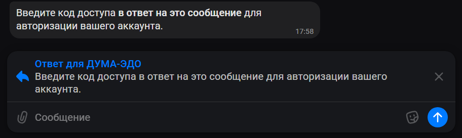
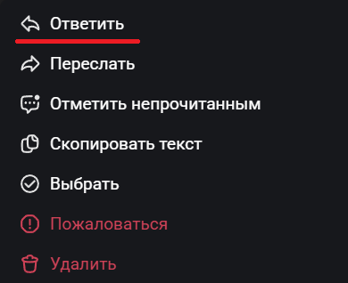
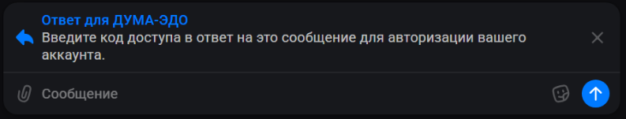
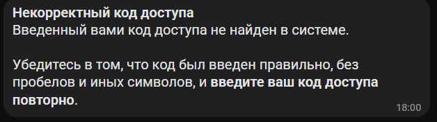
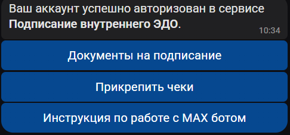
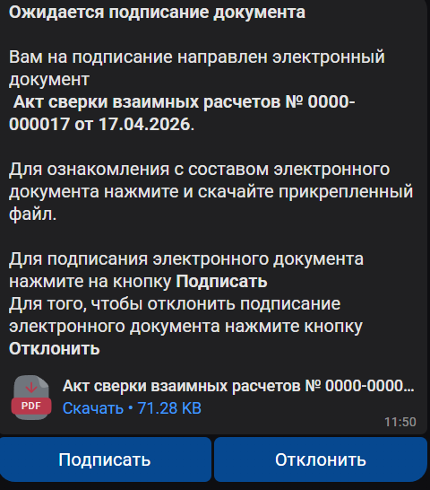
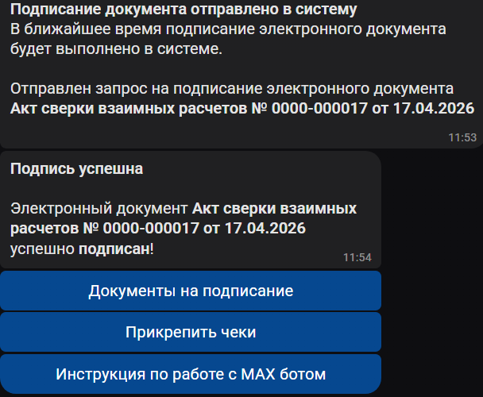
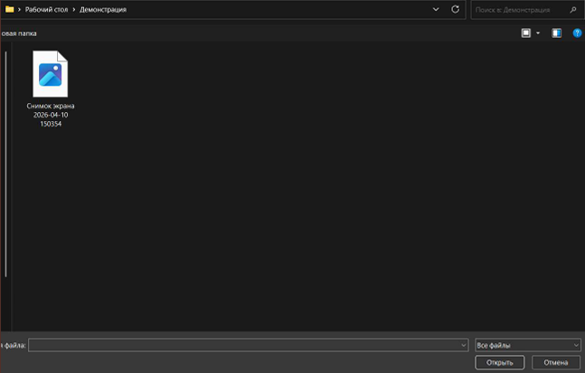

MAX бот “**ДУМА-ЭДО”** позволяет напрямую подписывать электронные документы без необходимости входа в систему 1С: Бухгалтерия Государственного учреждения 2.0.

## **Как авторизоваться в системе**

1. Откройте МАХ бот по ссылке: [**https://max.ru/id8601044590_1_bot**](https://max.ru/id8601044590_1_bot) или отсканируйте QR код:

   <image src="./rabota-s-max-botom-duma-edo.png" crop="0,0,100,100" scale="44" width="365px" height="546px" float="center"/>

2. Нажмите на кнопку “**начать**”.

   <image src="./rabota-s-max-botom-duma-edo-2.png" crop="0,0,100,100" scale="59" width="770px" height="921px" float="center"/>

   Система обработает ваш запрос и пришлет приветственное сообщение с дальнейшей инструкцией.

   <image src="./rabota-s-max-botom-duma-edo-3.png" crop="0,0,100,100" scale="51" width="502px" height="536px" float="center"/>

3. Нажмите на появившуюся кнопку **Авторизация**

4. Далее необходимо <highlight color="mint-green">**в ответное сообщение**</highlight> **ввести код доступа**, выданный администратором системы вашей организации.

   {width=912px height=273px}

<note type="danger">

Вводить код доступа необходимо обязательно **в ответ на сообщение**, указанное на скриншоте выше. Иначе бот проигнорирует ваше сообщение.

**На компьютере**, чтобы отправить **В ОТВЕТ** на сообщение, необходимо:

1. Навести на сообщение, на которое вы хотите отправить ответ, нажать **ПРАВУЮ** кнопку мыши, после чего, в открывшемся окошке, нажать на “***Ответить***“

   {width=390px height=318px}

2. Также, наведя на сообщение мышкой, справа от него появится кнопка в виде стрелочки, можно нажать на неё.

   <image src="./rabota-s-max-botom-duma-edo-6.png" crop="0,0,100,100" scale="50" width="199px" height="62px" float="center"/>

**На телефоне,** чтобы отправить сообщение в ответ, необходимо нажать на сообщение один раз, после чего, в меню, нажать на кнопку **“*Ответить*“**

{width=390px height=318px}

Либо, зажав пальцем выбранное сообщение, снизу появится маленькое меню с двумя кнопками. В таком случае, нужно нажать на кнопку со стрелочкой **“Ответить“.**

**❗Только так, отправленное боту сообщение будет считаться “*отправленным в ответ*“.**

Понять, что вы правильно выбрали сообщение, можно, если вы увидите на экране текст над полем ввода, в котором будет написано следующее:

{width=793px height=151px}

Картинка. Файл не найден. Возможно, он был удален.

Вводите **только** код доступа, **без пробелов и иных символов**.

В случае некорректного ввода кода доступа появится сообщение:

{width=628px height=176px}

</note>

При успешной авторизации бот отправит вам сообщение:

{width=486px height=227px}

## **Как подписать электронный документ**

1. При подписании электронных документов в 1С, когда очередь подписания дойдет до вас, М бот вас об этом оповестит сообщение

   {width=480px height=546px}

   К сообщению будет прикреплен **.pdf** файл, с которым вы можете ознакомиться перед подписанием.

   К сообщению будут прикреплены кнопки:

   -  **Подписать** - нажмите, чтобы подписать прикрепленный электронный документ;

   -  **Отклонить** - нажмите, чтобы отклонить электронный документ, если потребуется;

2. При успешной подписи вы получите следующие сообщения:

{width=608px height=500px}

При успешном отказе от подписания вы получите следующие сообщения:

<image src="./rabota-s-max-botom-duma-edo-13.png" crop="0,0,100,100" scale="71" width="662px" height="553px" float="center"/>

## **Как получить список документов, ожидающих вашего подписания**

При необходимости вы можете сами запросить список электронных документов, ожидающих вашего подписания. Для этого выполните следующие шаги:

1. В списке команд, прикрепленном к сообщениям, выберите **Документы на подписание**.

2. Ожидайте, пока бот запросит данные из системы 1С и отправит вам следующее сообщение:

   <image src="./rabota-s-max-botom-duma-edo-14.png" crop="0,0,100,100" scale="72" width="787px" height="231px" float="center"/>

3. Если в системе 1С ожидается подписание вами электронных документов, тогда вы получите список сообщений с данными электронных документов с командами **Подписать** и **Отклонить**.

4. Если у вас нет ожидающих подписания электронных документов, тогда вы получите следующее сообщение:

   <image src="./rabota-s-max-botom-duma-edo-15.png" crop="0,0,100,100" scale="54" width="535px" height="376px" float="center"/>

## **Как прикрепить чеки, если вы являетесь подотчетным лицом**

Для того, чтобы предоставить бухгалтерии чеки, выполните следующие шаги:

1. В списке команд, прикрепленном к сообщениям, выберите **Прикрепить чеки**.

   Бот отправит запрос в 1С для получения незакрытых документов, в которых вы являетесь подотчетным лицом, и пришлет сообщение:

   <image src="./rabota-s-max-botom-duma-edo-16.png" crop="0,0,100,100" scale="86" width="829px" height="99px" float="center"/>

2. После получения списка ожидающих документов вы получите сообщение с прикрепленными командами с названием ваших документов

   <image src="./rabota-s-max-botom-duma-edo-17.png" crop="0,0,100,100" scale="61" width="745px" height="384px" float="center"/>

3. Из списка команд **нажмите на название документа**, к которому необходимо прикрепить чеки и ожидайте следующих инструкций от бота.

4. Далее бот пришлет сообщение с просьбой прикрепить файлы чеков

<image src="./rabota-s-max-botom-duma-edo-18.png" crop="0,0,100,100" scale="69" width="805px" height="348px" float="center"/>

<note type="danger">

Прикреплять файлы необходимо обязательно **в чат**, иначе бот проигнорирует ваше сообщение.\
Прикреплять **обязательно** именно “**Файл**”.

</note>

**Как прикрепить файл с Компьютера:**

1. В нижней части экрана, где пишется сообщение, есть значок скрепки. Нажмите на него.

   <image src="./rabota-s-max-botom-duma-edo-19.png" crop="0,0,100,100" scale="93" width="862px" height="68px" float="center"/>

2. После этого откроется меню, в котором нужно нажать на кнопку “Файл“

   <image src="./rabota-s-max-botom-duma-edo-20.png" crop="0,0,100,100" scale="75" width="645px" height="621px" float="center"/>

3. Выберите файл/файлы

   {width=647px height=413px}

4. Двойным нажатием на файл, либо нажав на файл, затем на кнопку открыть, файл прикрепится к боту.

В качестве альтернативного варианта, можно перетаскивать файлы прямо в чат МАХ-а, в таком случае, нужно переместить файл/файлы в часть экрана, где написано “**Отправка без сжатия**“

<image src="./rabota-s-max-botom-duma-edo-22.png" crop="0,0,100,100" scale="81" width="1185px" height="791px" float="center"/>

**Как прикрепить файл с телефона**

1. В нижней части экрана у вас есть кнопка в виде скрепки, нажмите на неё

   <image src="./rabota-s-max-botom-duma-edo-23.png" crop="0,0,100,100" scale="64" width="1184px" height="269px" float="center"/>

2. У вас откроется следующее меню: Нажмите на кнопку со значком “картинки” справа вверху этого меню (на скриншоте подчёркнуто красным)

   <image src="./rabota-s-max-botom-duma-edo-24.png" crop="0,0,100,100" scale="56" width="620px" height="657px" float="center"/>

3. После нажатия, иконка картинки должна замениться на иконку “документа”

   <image src="./rabota-s-max-botom-duma-edo-25.png" crop="0,0,100,100" scale="58" width="621px" height="120px" float="center"/>

4. Далее, можно выбирать изображения из галереи, они будут добавлены как файлы.

5. После того, как вы прикрепите все сообщение, поднимитесь выше и нажмите на команду <highlight color="mint-green">**Завершить добавление к**</highlight> **\[название вашего документа\].**

   <image src="./rabota-s-max-botom-duma-edo-26.png" crop="0,0,100,100" scale="69" width="1006px" height="369px" float="center"/>

6. Ожидайте подтверждение отправленных файлов сотрудниками бухгалтерии.

   <note type="tip">

   Если вы внесли не все файлы, тогда, повторно выполните вышеуказанные действия и прикрепите только недостающие файлы.

   </note>

7. После того, как бухгалтерия примет ваши файлы, бот вас об этом уведомит.

   <image src="./rabota-s-max-botom-duma-edo-27.png" crop="0,0,100,100" scale="47" width="516px" height="485px" float="center"/>

8. Если все файлы приняты и нет отклоненных, процесс прикрепления файлов считается завершенным.

9. Если файлы отклонены, вы можете повторно отправить корректные файлы, повторив все действия выше.

<note type="info">

Прикрепите **только** недостающие файлы. Чеки, принятые бухгалтерией, повторно отправлять не требуется

</note>

## **Как в 1С согласовать файлы, отправленные подотчетными лицами**

<note type="info">

Данная инструкция предназначена только для сотрудников бухгалтерии, работающих в системе 1С.

</note>

Для того, чтобы согласовать присланные подотчетным лицом файлы (или отклонить их) выполните следующие действия:

1. Перейдите в раздел **Органайзер** -> **Внутренние документы пользователя**.

   <image src="./rabota-s-max-botom-duma-edo-28.png" crop="0,0,100,100" scale="80" width="653px" height="389px" float="center"/>

2. В шапке формы нажмите на команду **Согласование файлов подотчетных лиц**.

   <image src="./rabota-s-max-botom-duma-edo-29.png" crop="0,0,100,100" scale="76" width="701px" height="274px" float="center"/>

3. Откроется форма со списком файлов, ожидающих подтверждения.

   В верхней части формы укажите необходимые отборы.

   <image src="./rabota-s-max-botom-duma-edo-30.png" crop="0,0,100,100" scale="87" width="714px" height="165px" float="center"/>

4. Установите галочку **Принять** или **Отклонить** напротив необходимых файлов.

5. После установки всех галочек нажмите на команду <highlight color="mint-green">**Согласовать решение по подотчётному лицу**</highlight>.